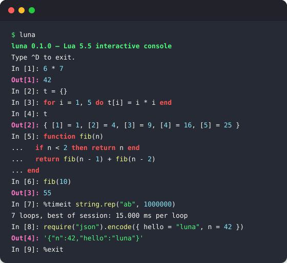

[English](README.md) | [中文](README.zh.md)

<p align="center">
   
</p>

<h1 align="center">luna</h1>

<p align="center">A batteries-included Lua runtime for scripting, tooling, and lightweight services</p>

<p align="center">
<a href="https://github.com/cuihairu/luna/actions/workflows/cmake.yml"></a> <a href="https://github.com/cuihairu/luna/actions/workflows/nightly.yml"></a>  <a href="LICENSE"></a> <a href="https://cuihairu.github.io/luna/"></a>
</p>

<p align="center">
  
</p>

## What luna is

luna is a **batteries-included, general-purpose Lua runtime** serving three kinds of work: scripting, tooling, and lightweight services. A single binary ships a REPL, a modern standard library, Node-style module resolution, directory-based plugins, package management, and opt-in async I/O.

The Lua ecosystem has few general-purpose tools worth reaching for: every new project starts by assembling the surrounding infrastructure. luna prepares that layer in advance and hands the time back to the work itself.

Node.js is an **architectural reference, not a product identity**. luna is a Lua runtime first; the Node-style experience comes second. Engineering habits such as module resolution and the shape of the standard library follow Node, and the comparison table lives in the [architecture notes](https://cuihairu.github.io/luna/architecture) on the docs site. Identity and core remain Lua.

The IPython-style REPL is one of these tools, not the whole of luna.

## Thirty seconds

```bash
luna                     # bare REPL: inspect values, try libraries, sketch snippets
luna build.lua           # run a script file (build / automation / tooling, like lua)
luna -e 'require("http").serve(...)'   # a lightweight service in one line
```

An HTTP service is one line as well; `^C` stops it:

```bash
luna -e 'require("http").serve(function(req, res)
  res:json({ hello = "luna", path = req.path }) end)'
```

TCP echo is equally one line (reads a line, echoes it back; `^C` stops it). From another terminal, `echo hi | nc 127.0.0.1 9000` prints `echo: hi`:

```bash
luna -e 'require("net").serve("*", 9000, function(c)
  c:send("echo: " .. (c:receive("*l") or "") .. "\n") end)'
```

In the REPL, `6 * 7` answers `Out[1]: 42`, `%timeit` measures performance on the spot, and `%whos` lists every global defined so far. Details in [CLI & REPL](https://cuihairu.github.io/luna/guide/cli-repl).

## Get luna

**One-line install** (installs the latest daily build into PATH, verifies with `luna --version` once done; rerun to upgrade):

```bash
# Linux / macOS
curl -fsSL https://raw.githubusercontent.com/cuihairu/luna/main/install.sh | sh
```

```powershell
# Windows (PowerShell)
irm https://raw.githubusercontent.com/cuihairu/luna/main/install.ps1 | iex
```

Artifacts ship as a **rolling nightly Release** (fixed tag [`nightly`](https://github.com/cuihairu/luna/releases/tag/nightly): every green run clears the old assets, uploads fresh ones, and re-publishes, with `.sha256` sidecars for verification). Assets on a public repository are public and pull anonymously, no credentials of any kind; the installer self-verifies with `luna --version`. Actions artifacts are per-run local copies, not a delivery channel. Current artifact matrix: `linux-x86_64`, `linux-aarch64`, `macos-aarch64`, `windows-x86_64`.

- **Daily build**: the [Daily Build](https://github.com/cuihairu/luna/actions/workflows/nightly.yml) workflow runs on a schedule (UTC 01:23): Release-type build plus smoke checks, publishing the rolling nightly Release. It is a pure artifact pipeline; full test coverage is the job of the CI on every push, and the nightly window does not carry the network-dependent rocks suite. The platform zips `luna-nightly-<os>-<arch>` (the binary plus the `luna_modules/` module sidecar; the binary resolves the Lua strategy layer from its own directory first) and their `.sha256` sidecars are cleared and re-uploaded each run; run-page artifacts (`pkg-<os>-<arch>` for 3 days, aggregate `daily-build` for 14 days) are reference copies only. The daily test matrix (`daily.yml`, UTC 21:13 + manual) reruns the full suite per platform with all four legs green-gated (promoted out of canary: Windows 2026-10-08, macOS 2026-10-09), so a red leg fails the run outright; the delivery workflow (`nightly.yml`) keeps the Windows build/delivery leg on `continue-on-error` — a red Windows leg does not hold back the rolling nightly Release. The nightly Release is the lifeline; the artifact page and the Release page corroborate each other.
- **From source**: the only dependencies are CMake ≥ 3.14 and a C/C++ compiler; everything else lives in `deps/`:

```bash
cmake -S . -B build -DCMAKE_BUILD_TYPE=Debug
cmake --build build -j
ctest --test-dir build       # every test suite should be green
```

On macOS, `brew install pkg-config autoconf cmake`; the optional `libssl-dev` enables the crypto module. See [Getting started](https://cuihairu.github.io/luna/guide/getting-started).

## Toolset

| Capability | Description | Docs |
| --- | --- | --- |
| REPL | replxx line editing, scintillua/LPeg live highlighting, `^C` interruption, history recall, `In[n]`/`Out[n]` | [CLI & REPL](https://cuihairu.github.io/luna/guide/cli-repl) |
| Magic commands | `%time` `%timeit` `%hist` `%whos` `%eval` `%load` `%reset` `%plugins` `%help` …, registrable by plugins | [CLI & REPL](https://cuihairu.github.io/luna/guide/cli-repl) |
| Runtime introspection | `luna ps` lists attachable processes (live/stale + command line); `%info` `%modules` `%stats` `%gc` `%globals` probe the current process; `luna --attach <pid>` offers the same remotely | [CLI & REPL](https://cuihairu.github.io/luna/guide/cli-repl) |
| Event loop | `loop`: timers, TCP/Unix/TLS, async fs, signals, subprocesses; automatic drain at script end | [Event loop](https://cuihairu.github.io/luna/guide/loop) |
| Async tasks | `task`: `task.run/await/sleep/promise/promisify`, handles support cooperative `:cancel`; `%tasks` to observe | [Async tasks](https://cuihairu.github.io/luna/guide/tasks) |
| Scaffolding | `luna new plugin/package/script <name>` generates starter code from built-in templates; `--list` enumerates templates, refuses existing targets | [Examples & scaffolding](https://cuihairu.github.io/luna/guide/examples) |
| Official examples | Eight ready-to-run examples in `examples/`: CLI, file tooling, HTTP/TCP services, scraping, build, game scripting, automation; documented output is captured from real runs | [Examples & scaffolding](https://cuihairu.github.io/luna/guide/examples) |
| Sandbox runtime | `luna --sandbox`: module whitelist, native loading disabled, no subprocesses / file writes / environment; `LUNA_SANDBOX_FUEL`/`LUNA_SANDBOX_MEM` cap compute and memory | [Sandbox runtime](https://cuihairu.github.io/luna/guide/sandbox) |
| One-line servers | `luna serve` for a static directory; `http.serve()` static or programmable; `net.serve()` TCP echo | [Standard library · http](https://cuihairu.github.io/luna/stdlib/http) |
| Modules | Relative require, `luna_modules/` walk-up, `package.json`-style manifest `main`, `package.loaded` cache semantics | [Module system](https://cuihairu.github.io/luna/guide/modules) |
| Standard library | fs/net/http/csv/ini/toml/yaml/xml/zlib/crypto bind mature C libraries or LPeg; json/path/util/querystring/url/process/console/events/stream/assert are pure Lua following Node semantics; shipped alongside the binary in the `luna_modules/` sidecar (the `luna.*` policy layer is embedded in the binary) | [Standard library overview](https://cuihairu.github.io/luna/stdlib/) |
| Logging | `logging`: six threshold levels, log4j-style appenders (console / file / rolling file / socket; lualogging 1.8.2, bundled) | [Standard library · logging](https://cuihairu.github.io/luna/stdlib/logging) |
| Plugins | `./plugins` → `~/.luna/plugins` → `$LUNA_PLUGIN_PATH`, manifest + entry point, isolated failures | [Plugin development](https://cuihairu.github.io/luna/guide/plugins) |
| Architecture | Thin C kernel + embedded Lua strategy layer + extension points; design comparisons and event-loop rationale | [Architecture](https://cuihairu.github.io/luna/architecture) |

## VS Code

`tools/luna-vscode/` is the official extension, distributed as a vsix (no marketplace): `cd tools/luna-vscode && npm install && npm run package`, then install it via **Extensions: Install from VSIX…**. Completions and hover come from a symbol snapshot generated by the real runtime's own introspection (`scripts/regen.sh` re-dumps it; hand-written symbol tables are not allowed); when attached to a process, completion merges the target's own live candidates over the serve protocol. `Run Lua File` / `Run Selection` spawn `luna` into an output channel; attach drives the live process line by line (`ctrl+enter`). No Lua grammar ships — pair it with a community Lua language plugin for syntax; this extension only adds luna-specific faces.

## Documentation

- Docs site: **https://cuihairu.github.io/luna** — guides (getting started / CLI & REPL / module system / plugin development / package management / event loop / async tasks / examples & scaffolding / sandbox runtime), per-module standard-library reference, configuration and environment variables, build and testing, FAQ, architecture;
- Source lives in [`docs/`](docs/), built with VitePress: `cd docs && pnpm install && pnpm run docs:dev` for a local preview.

## Development

- Tests: sixteen ctest suites (luna / repl / cli / complete / introspect / highlight / magic / modules / plugins / serve / loop / rocks / line / linedit / main / covsum); run `ctest --test-dir build` after changes. Coverage uses a separate Profiling-instrumented tree, see [Build and testing](https://cuihairu.github.io/luna/other/build);
- Pushes to main that touch `docs/` trigger CI to build and publish the docs site to Pages (deployment does not count as a release).

## Local test policy

CI and local development split by change surface — editing a doc should not trigger a full compile.

1. **Docs-only changes** (`*.md`, `docs/**`, `LICENSE`, `.gitignore`, `*.svg`, `.editorconfig`): the main CI workflow's `paths-ignore` skips these paths, so no build is triggered.
2. **Code changes**: the main CI workflow runs the full `ctest -C <build-type> --output-on-failure` suite on every push. Locally, run a subset first for speed with `ctest -R '<changed test>'`, then the full suite before pushing.
3. **Full suite** (`ctest --output-on-failure`): required before every push; CI runs it automatically on any push that touches code.

